moodle-theme_dimensions
=======================

[](https://github.com/uaiblaine/moodle-theme_dimensions/actions/workflows/ci.yml?query=branch%3Amain)

A Moodle 5.3 theme for catalogues people browse: a category showcase with one filter line, course
landing pages, a login page of its own, focus mode and Moodle's competency pages in one design.

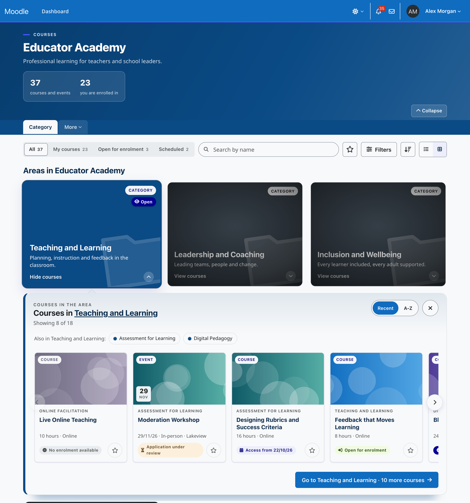

Dimensions is a child of
[Boost Union](https://github.com/moodle-an-hochschulen/moodle-theme_boost_union), which makes it a
grandchild of Boost. It inherits everything Boost Union does - every setting, every template, every
line of SCSS - and adds its own login page, category showcase, course landing pages, focus mode and
course notice on top of it.

It is the theme of the *dimensions* family of plugins, beside
[local_dimensions](https://github.com/uaiblaine/moodle-local_dimensions),
[block_dimensions](https://github.com/uaiblaine/moodle-block_dimensions) and
[block_compass](https://github.com/uaiblaine/moodle-block_compass), and it is meant to grow around
their user experience, Moodle's competency framework first (see the roadmap below).

The starting point is the official
[Boost Union Child](https://github.com/moodle-an-hochschulen/moodle-theme_boost_union_child)
boilerplate. The structure of `config.php`, `lib.php` and the SCSS inheritance settings comes from
there unchanged, so the upstream documentation about how a Boost Union child theme works applies to
this theme as well.

The screenshots below were taken on Moodle 5.3 with generated demo data, as a learner unless a
caption says otherwise.


The category showcase
---------------------

With *Category showcase > Show the category showcase* on, `/course/index.php?categoryid=N` is the
theme's own page: a hero with the category's name, tagline, description, counts and tabs, then the
courses of the category and its subcategories as cards or a dense list, with search, state filters,
filter groups built from course custom fields, a start-date filter, a category tree and real paging.
It works with JavaScript off; with JavaScript on, every choice is applied in place.

- **Organised by area, A-Z or Recent.** By area, each subcategory is a poster, and its courses
  open in a panel between the rows, with the area's own order (Recent or A-Z) and a link to its
  page. A-Z and Recent list every course of the subtree, with the category tree beside them.
- **Cards that answer "can I get in?".** Each card shows the enrolment state for the reader
  (enrolled, open for enrolment, application under review, access from a date, no enrolment
  available and more), a favourite star and a "More information" dialogue.
- A category manager styles the hero from the *Category appearance* tab: layout, background image,
  a free colour pair refused below the WCAG AA contrast of 4.5:1, up to three crests, a card cover
  and a short cover video that plays muted on hover.
- `/course/index.php` without a category is a **directory** of the top-level categories.
- A category local_unlistedcourses holds **public** has a page for visitors who are not logged in,
  with forced login left on, and the root directory can be opened to visitors too; both are off
  until an administrator switches them on. A category held **unlisted** is withheld from every
  listing the theme renders.

### The filter line

Every control of the listing sits on one line, in a fixed order: the scope, the search, the
favourites star, *Filters*, *Organise* and the view (List or Cards, icons only).

- **The scope** - *All*, *My courses*, *Open for enrolment*, *Scheduled* - is a set of counted
  cells. The rarer states, *Under review* and *Free access*, are in the panel under *More
  statuses*; one choice holds across both.
- **The star** shows the reader's favourites, on top of whatever the scope says. Each count is
  taken with the other control applied, so a number is always what pressing it would leave.
- **What each category was left in is remembered** for each reader: the scope, the organisation,
  the view and the filters fill in a bare address. An address that names a criterion always wins,
  so a shared link means the same to whoever opens it.

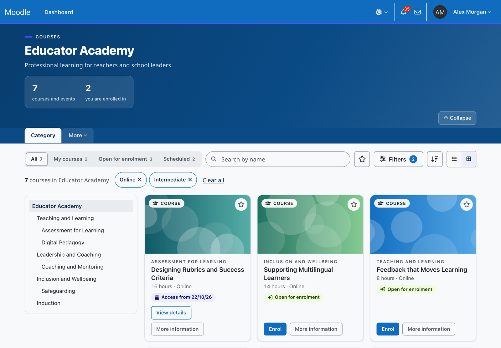

**Chips under the line.** A second row shows only while something narrows the listing: the count
sentence, then one chip per criterion the line does not already show (a custom field, the period,
a state from *More statuses*, the tree's category). Each chip removes its own criterion and keeps
everything else; *Clear all* appears from two criteria up. The hero's counts follow the filters.

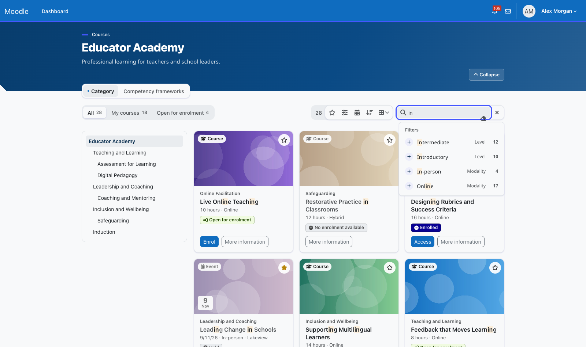

**Search with suggestions.** Pressing the search opens a list of filters before anything is typed
("Start with a filter"); typing narrows it to the filter values whose label or group matches, each
with the count it would give. Choosing one adds its chip and empties the field. The typed text also
searches the listing as you type, and the matched letters are marked in the course titles. `/`
opens the search while the line is on screen and no field has the focus.

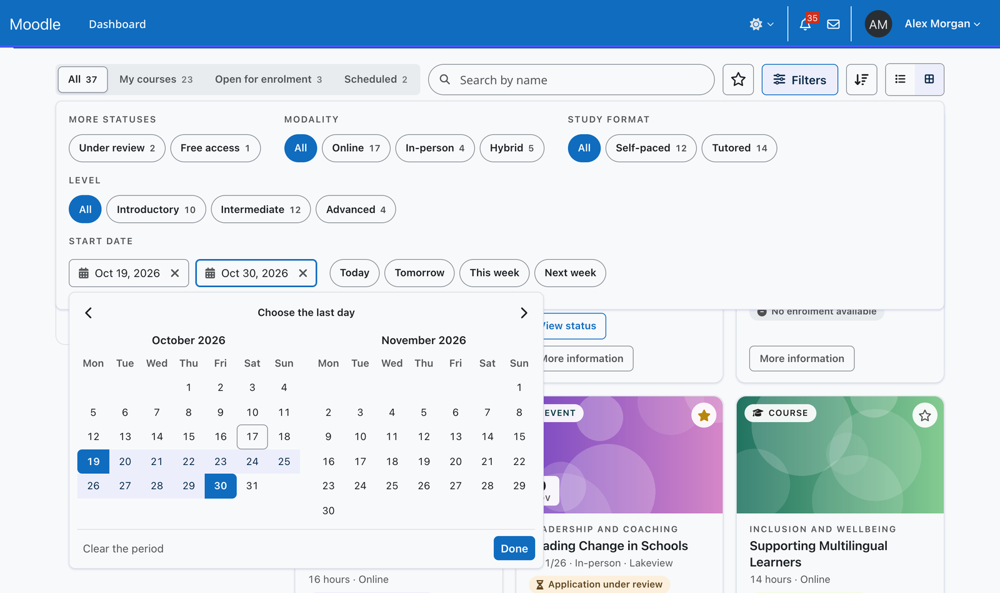

**The Filters panel** opens under the line with every group the site configured from course custom
fields, each option counted, and the start-date period. The period is two boxes and one calendar
of two months: press a start day, then an end day, or take a quick option (Today, Tomorrow, This
week, Next week). *Done*, or a press outside, applies it; Escape leaves the period that was in
force. Days are the site's days, never the browser's. The badge on *Filters* counts what the panel
holds.

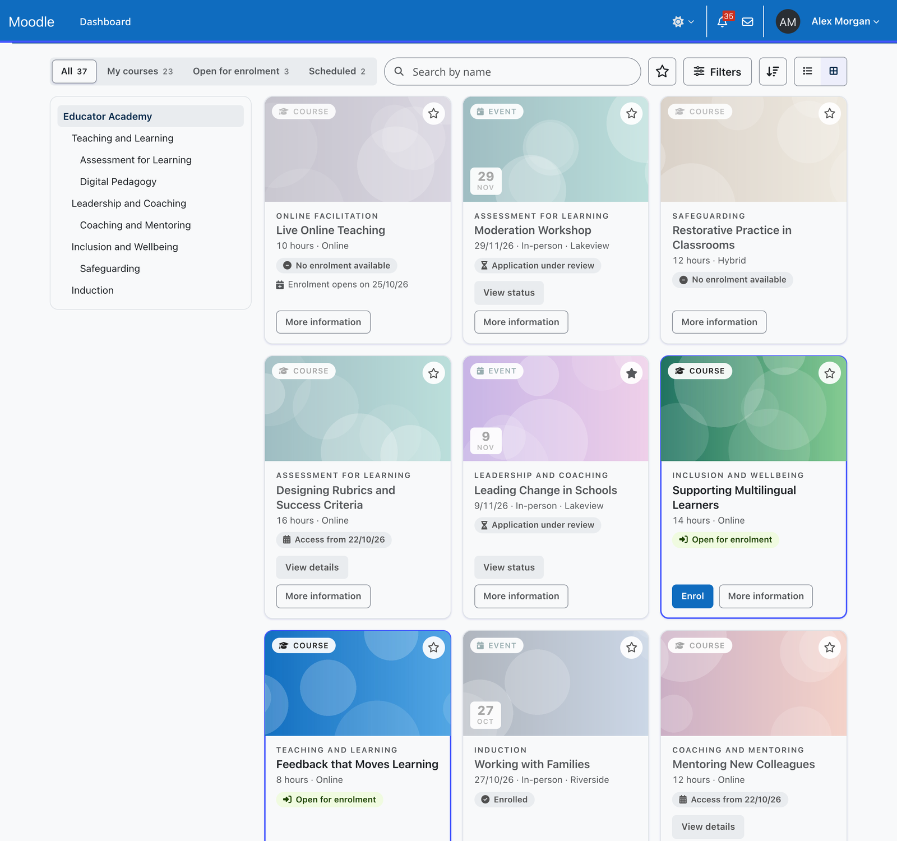

**Preview before you press.** Pointing at a scope cell, the star, a panel option or a suggestion
rings the cards it would keep and recedes the rest, by colour rather than transparency, so the
receding cards stay legible. It answers to a mouse, a pen and keyboard focus, never to a finger, and
it decides from what each card states: a card that does not state the fact asked about is left as
it is rather than guessed.

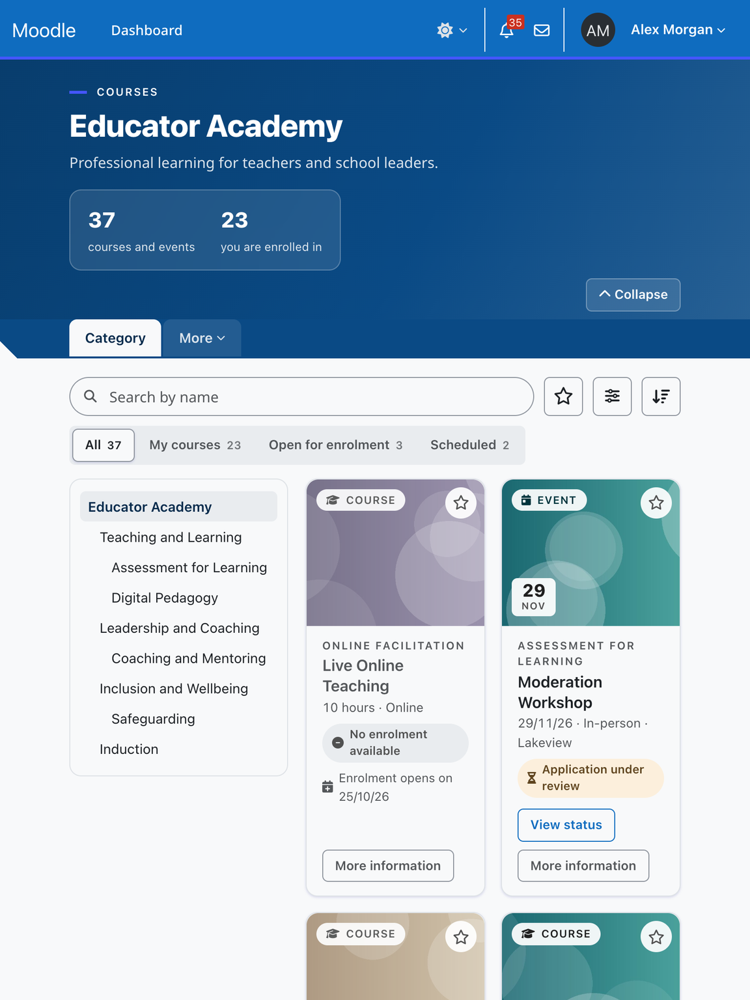

**It folds on its own width.** The line measures its own space, not the screen's, and takes the
first of four steps at which it fits: everything; *Filters* without its word; the search as an
icon; two lines, with the scope on the second line and the view inside *Organise*.

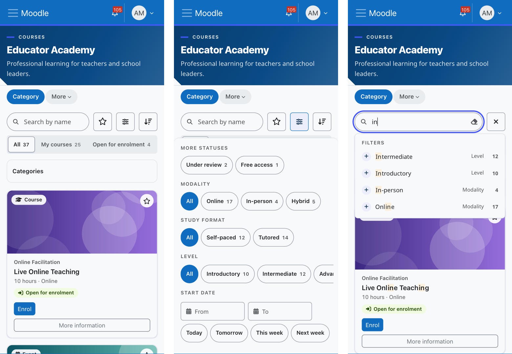

**On a phone** the scope scrolls sideways, the *Filters* panel is a bottom sheet, and the search,
pressed, grows over the whole line with a close button at its end. Without JavaScript the line
simply wraps, and every control still works as an ordinary form.

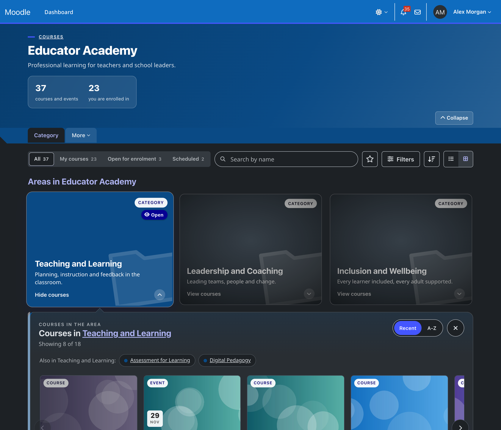

The showcase follows Moodle's light and dark colour modes.


Custom login page
-----------------

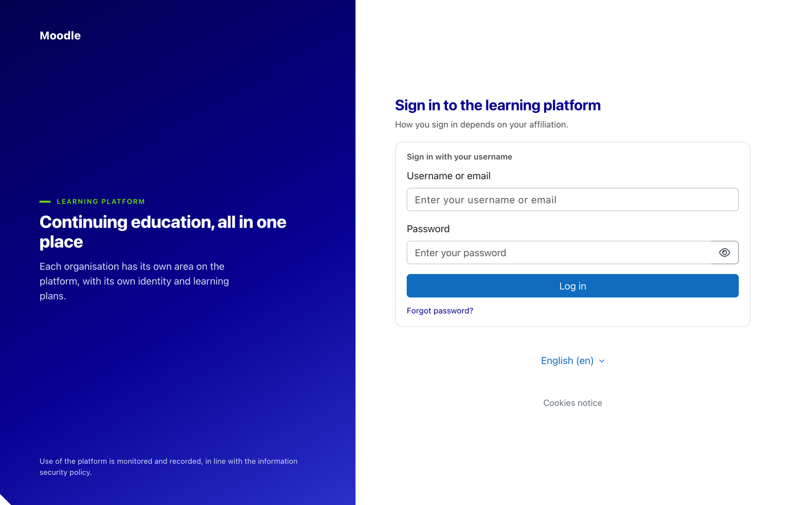

On by default (*Login page > Login page to show*). The theme draws the login page itself: an
institutional panel on the left - the logo, a kicker, a title and an optional monitoring notice -
and, on the right, the ways in, stacked with an "or" between them: the identity providers first,
then the username and password form, then "Create my account" whenever core's self registration is
on. The panel follows the whole login flow (password recovery, the MFA challenge and every other
page on the login layout).

- **No request to an identity provider before a choice.** Core renders each provider's image from
  the provider's own address, which makes every visitor's browser announce itself to it. This page
  draws known providers from the Font Awesome Brands font Moodle already ships, and shows a
  provider it has no mark for by name only, unless its image is served by this site.
- **A reset hint after the second failed login in a row**, counted per browser session and never per
  account, so it reveals nothing about which usernames exist.
- **The panel's copy is a setting** (*Login page > Institutional panel*); a field left empty shows its
  language string, which follows each user's language.
- While the page is on, Boost Union's login page settings that shape the form are not read; core's
  own switches (`showloginform`, the enabled authentication plugins, `guestloginbutton`,
  `registerauth`) decide what is drawn. *Leave it to Boost Union* gives Boost Union's page back
  exactly as configured there.


Course landing pages
--------------------

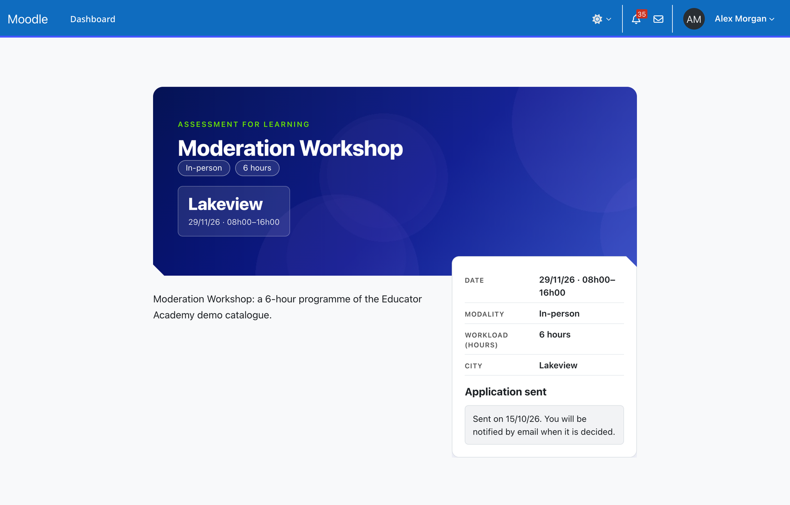

An enrolment page for each course that opts in, at `/theme_dimensions/landing/<courseid>` on a site
whose router is configured (and at `/theme/dimensions/landing.php?id=<courseid>` otherwise). A course
opts in by choosing a page model (*Course* or *Event*) in the *Course landing page* custom fields of its
settings, which also hold the modality, workload, audience, programme, certification, venue, a
reviewed public description, a presentation video address, up to four badges and a share picture.
The page shows only the enrolment methods the current user can actually use, and
`/enrol/index.php?id=N` forwards to it for a course with a model. Each page gets a short public
address that can be dictated over the phone (`https://<site>/p/batepo`) once Moodle's router is
configured. The theme's *Course landing page* settings can give new courses a page model, a modality and a
study format to start with; a course that already exists never changes when they do. They also choose how the
banner at the top of every landing page is drawn (`theme_dimensions/landingheroformat`): as a card in the content
column, the default, or full width, from edge to edge under the navigation bar as the category pages draw theirs.


Focus mode
----------

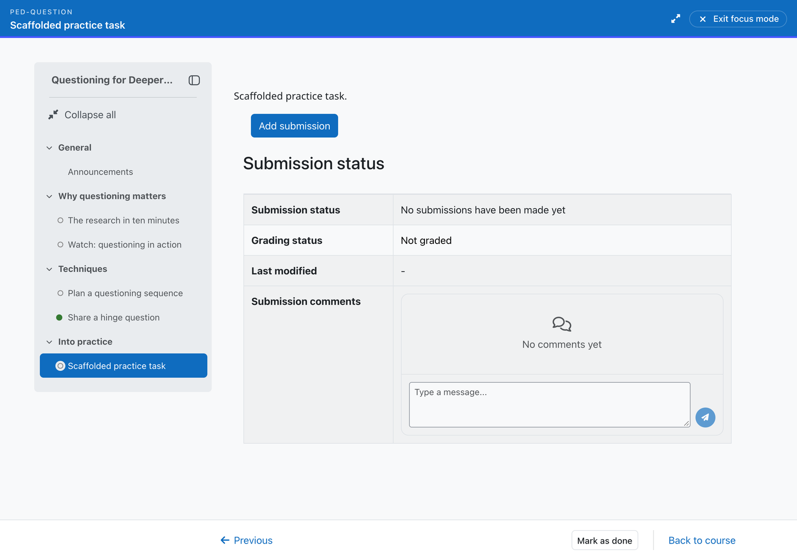

An activity page opens in a reduced shell: a bar carrying the activity name where the navigation bar
normally is, the course index and the block drawer kept, no breadcrumb and no tabs. A course switches
it on with its *Focus mode on activities* checkbox; in a course that did not, a *Focus mode* button in
the navigation bar opens that course's activities focused for the rest of the browser session. The
reading width is remembered per user. Quiz attempt pages are excluded by default, and `?focusoff=1`
renders any one request with the ordinary theme.


Course notice
-------------

One notice region replaces Boost Union's course related hints on every course page, under the same
Boost Union settings, capabilities and texts: a bar of chips that sums the course's state up, with
the details under it. For whoever edits the course, a course with a landing page gets a
*Promotion* section with its public addresses and copy buttons.


Competency framework
--------------------

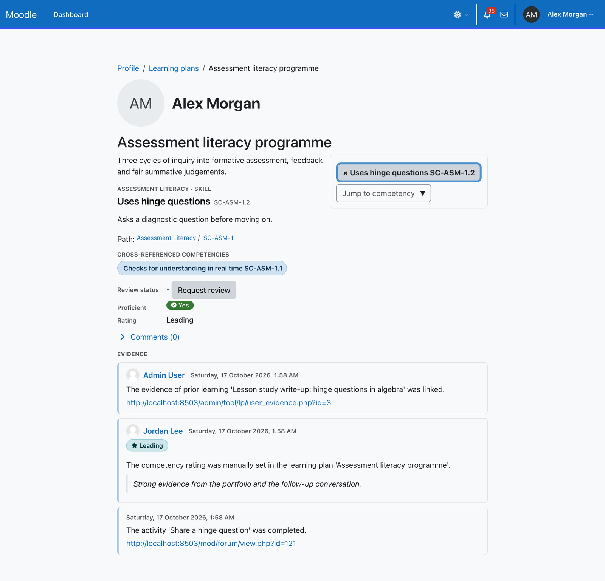

Moodle's competency pages and dialogues - the learning plans and their user competencies
(`admin/tool/lp`), the competency breakdown report of a course (`report/competency`) and the
learning plans block (`block_lp`) - wear the theme's design and the dimensions family's colour
tokens, the ones local_dimensions and block_dimensions read, so the three look like one product.
What these pages decide and show to whom is core's, unchanged: the theme restyles and re-renders,
nothing else.

- Proficiency is never said by colour alone. A rating is a pill with its name and a star; beside
  it, *Proficient* (a check) or *Not proficient* (an exclamation) in words; *Not rated* is a pill of
  its own. On the breakdown report this replaces core's green cell.
- The competency summary, the evidence (one card per piece, with who acted, when, and the rating it
  carried), progress bars that name themselves and print their percentage, the related
  competencies as chips, the statistics of a course or a learning plan template, the rating dialogue
  and the navigation panels are restyled copies of core's templates; every hook core's scripts and
  tests read is kept.
- The larger pages (the learning plan's own page, the course competencies page, the frameworks,
  the competency trees and pickers, the rule configuration) keep core's templates and are styled
  by the stylesheet alone.
- Light and dark colour modes alike, from the theme's tokens and Bootstrap's own: a Boost Union
  flavour's brand colour reaches these pages too.


More features
-------------

### Profile access rule

A person may open another person's profile only when they can see every profile, when they share a
course whose participant list they may see, or when they come from the page of a course in which the
other person is a course contact. The rule only ever narrows core's answer, and it applies while
core's `forceloginforprofiles` is on (Boost Union's recommendations overview says whether it is).

### Guest access

A course whose guest access needs no password gets an *Enter as guest* address beside its landing
page's: a visitor lands on the course as the guest account in one step, while link previews never
open a guest session. The login page tab also sets where the guest account goes from the site's
home page (*Guest home page*).

### Open Graph

The public landing page and the public category page carry Open Graph tags (title, the reviewed
public description, a 1200x630 preview image, canonical URL, site name, locale), so a shared link
unfurls in messaging apps and social networks. They are `noindex` unless the site is open to search
engines.

### The navbar while reading

On an activity page and the course page, once the reader scrolls past the page title, the navbar
gives way to a context bar: the activity's or the course's name, the course and its progress, the
activity's completion status, the course index, the way into focus mode and, for an editor, the edit
mode switch. It comes in with a colour of its own, so the change is seen at once: the *Context bar
colour* setting, or, left empty, a lighter or darker step of the brand colour; either way its text
is white or dark, whichever reaches the contrast WCAG AA asks for. On a phone the two bars slide
past each other vertically; on a wider screen they fade.

On a phone the navbar keeps the menu, the brand, the notifications and the user menu. The messaging
drawer, Mail (local_mail), focus mode and the edit mode switch move to the top of the user menu, the
last two to the context bar as well; each moves only where the navbar would have shown it.

On a phone Moodle hides the activity navigation footer ("Next", "Previous" and the completion
button) while the reader scrolls down; the theme brings it back near the end of the page, where
the reader looks for "Next".

### Boost Union flavours compiled ahead of time

Boost Union compiles a flavour's stylesheet only when a browser first asks for it, so after every
cache reset (a flavour saved, a theme setting changed, a cache purge, an upgrade) the first visitor of
each flavour waits for a whole theme compile: 23 s measured on a development site, where the same
request for a sheet already compiled takes 0.01 s. The theme compiles them before anybody asks.

- **The scheduled task** *Compile the flavour stylesheets no visitor has asked for yet*
  (`\theme_dimensions\task\warm_flavour_css`) runs every minute. A cache reset has no event to listen
  to, so the next run is the soonest the missing sheets are seen. While every sheet is built a run is
  one query and a file check per flavour.
- **Which flavours:** those a page can be served. That means a flavour applied to at least one
  category or cohort, or offered for choice in *Look*. A flavour that applies to nothing is not
  compiled.
- **One process per flavour.** Boost Union cannot compile two flavours in one PHP process, so each
  sheet is compiled by a child process, one at a time: about 8 to 11 seconds of CPU and 150 MB of
  memory each, on the machine that runs cron. The child is started with cron's own PHP binary, or
  with *Path to PHP CLI* (`pathtophp`). With neither, or with `proc_open()` disabled, nothing is
  compiled and flavours are compiled on first request, as Boost Union does without this theme.
- **A flavour whose SCSS does not compile** is tried once per theme revision: the next cache reset
  tries it again.
- **Several web servers:** the task fills the shared cache (`core/postprocessedcss`) and the
  compiled file of the machine that runs cron. Every other web server writes its own file from the
  shared cache on its first request instead of compiling it.

The same work can be run by hand, for instance as a step of a deployment
(see *Installation*):

```
php theme/dimensions/cli/build_flavour_css.php --all
php theme/dimensions/cli/build_flavour_css.php --all --dry-run
```

### Pages strip

With local_page installed, a category page names that category's pages under its hero, as the
plugin's own rules let the reader see them.

### Course ratings

With tool_courserating installed, a course card whose course the plugin rates and somebody has rated
opens its meta line with the rating - a star, the average and the number of ratings - for every
reader who sees the card, the visitor of a public category included, as the plugin itself shows a
rating to whoever may see the course listed. The course dialogue of a logged-in reader adds the
plugin's rating block: the average, its stars and the distribution of the ratings and, where the
course holds reviews the plugin lets the reader see, a link that opens the plugin's own reviews
popup. The theme only reads the plugin's summary table, one statement per page of cards, and keeps
nothing of its own; a site without the plugin, or one where it rates no course, reads nothing.

### Boost Union settings that change the course cards

The theme is a child of Boost Union, so three of Boost Union's course overview settings decide the
theme's course cards as well as Boost Union's own: the category showcase's cards, in both the card
and the list view (the grouped panel included), and the step popover of the calendar's trails view.
They apply only because the theme names Boost Union as its parent; the theme adds no setting of its
own for them. An administrator finds them under *Site administration › Appearance › Boost Union ›
Look*, tab *Dashboard / My courses*.

- **Show course progress** (`courseoverviewshowcourseprogress`). *No* removes the progress row and
  its percentage from every card; the theme then reads no progress at all. A completed course keeps
  its completed seal.
- **Course image source** (`courseoverviewimagesource`). Decides the picture of a course that has
  no course image of its own. With *Course image with pattern fallback* (the default) the theme
  draws the course category's cover: the category's colour, inherited from the nearest category
  above it that has one, else the site's brand colour, under the same light gradient as every
  cover. With *Course image with fallback image* and a fallback image uploaded, every such course
  shows that image; with no image uploaded, the category's cover again. The same picture reaches
  every page that asks the theme for it, the Dashboard and *My courses* included.
- **Show course images** (`courseoverviewshowcourseimages`). With *Card* unchecked the cards are
  drawn without their cover, and so is a course's popover in the calendar's trail view; with *List*
  unchecked the list view's rows are drawn without their thumbnail. *Summary* changes nothing on the
  theme's cards, which have no summary view.

### The calendar blocks

Moodle's *Calendar* (month) and *Upcoming events* blocks show the theme's calendar: a month with a
dot per event key and a short agenda of the next events, from the same events as the theme's
calendar page (`/theme/dimensions/calendar.php`), under the keys and filters the reader saved there.
Each day and event leads to that page. The page itself shows a month or a week (the switch above the grid,
`?view=week`), and a visitor of the public calendar gets both. The agenda keeps Moodle's own *Upcoming events
look-ahead* and *Maximum upcoming events* preferences. On a course page, for a visitor or the guest account, and
for a calendar type other than the Gregorian, both blocks keep Moodle's own content. The setting
*Draw the calendar blocks with the theme's calendar* (`theme_dimensions/calendarblocks`, on by
default) switches this off.

The theme's calendar withholds what Moodle's shows in one case: an event of a category that
local_unlistedcourses keeps unlisted for the reader. A theme can only change what its pages draw,
so these keep Moodle's own rules and still show such an event:

- the Moodle App, which reads Moodle's calendar web services directly;
- any other client of Moodle's calendar web services;
- the *Timeline* block, which stays Moodle's own.

While *Send core's calendar to the theme's calendar* is on, every view of Moodle's calendar
(`calendar/view.php`, the upcoming view and a course's calendar included) leads to the theme's page,
and the calendar export's feed (`calendar/export_execute.php`, the subscription URL the export page
hands out) is answered by the theme's copy of Moodle's script, which leaves out the same category
events; switched off, both are Moodle's own again. Where the difference matters with the setting off,
switch the calendar export off (*Site administration > Appearance > Calendar*, untick *Enable
calendar export*). A site that switches the theme's blocks off should also
remove the *Calendar* and *Upcoming events* blocks from the default block regions (the Dashboard and
the site home), so that every calendar a reader meets follows one set of rules.

### The public calendar

The setting *Public calendar* (`theme_dimensions/calendarpublic`, off by default) opens the theme's
calendar page (`/theme/dimensions/calendar.php`) to visitors who are not logged in, even while the
site forces login. A visitor sees two kinds of items and nothing else: the events of the course
categories local_unlistedcourses marks public (with every category above them visible and none
unlisted), each leading to the category's public page, and the public event courses (courses of the
event model whose landing page is public), each leading to its landing page. Descriptions are shown
as text, without images. The page draws them from the web service
`theme_dimensions_get_public_calendar_range`, which answers without a session
(`lib/ajax/service-nologin.php`) and refuses any logged-in session. Nothing of a visitor is stored,
nothing is cached between requests, and the page is marked `noindex` unless the site is open to
search engines. The theme adds no link to it in a visitor's navigation: share its address. Off, a
visitor who opens it is sent to the login page; the guest account keeps Moodle's own calendar.


Requirements
------------

- Moodle 5.3. The theme requires `2026100500` and declares `$plugin->supported = [503, 503]`; it
  is not meant to be installed on any other release.
- PHP as Moodle 5.3 requires it.

### Required plugins

| Plugin | Version | Why |
|---|---|---|
| [theme_boost_union](https://github.com/moodle-an-hochschulen/moodle-theme_boost_union) | 2026100500 or later, its Moodle 5.3 version (`MOODLE_503_STABLE`, v5.3-r1 or later) | The parent theme. |
| [local_unlistedcourses](https://github.com/uaiblaine/moodle-local_unlistedcourses) | 2026100505 or later | Decides which courses and categories are listed, unlisted or public; the category showcase, the public pages and the listings ask it. |

### Optional plugins

| Plugin | What it adds |
|---|---|
| [customfield_picture](https://github.com/uaiblaine/moodle-customfield_picture) (recommended) | The field type of the landing pages' four badges and their share picture. Without it, or with the Picture type disabled, those five fields are not created and nothing draws them; the theme's recommendation in Boost Union's overview says so. Install it later and use that recommendation's fix to create them. |
| auth_loginsteps | Its logo and identity provider data on the login page, its own shell for the second factor and privileged session pages, and the CPF mask of the login form (`logincpfmask`). The theme asks it by class name and never requires it. |
| [local_page](https://github.com/uaiblaine/moodle-local_page) | The pages strip on a category page. Without it the strip is simply not drawn. |
| [mod_subcourse](https://github.com/uaiblaine/moodle-mod_subcourse) | The *Trail* page model: a course whose Subcourse activities are the courses of a trail, in order. Without it, or with the module disabled, the Trail line of the page model is not offered (it stays in the field, whose lines are positions) and a course saved as a trail reads as a course. |
| [tool_courserating](https://github.com/marinaglancy/moodle-tool_courserating) | The course ratings on the showcase's cards and in its course dialogue (*Course ratings* above). Without it, or where it rates no course, nothing is drawn or read. The theme asks it by class name and never requires it. |


Installation
------------

Install the plugin like any other plugin, to the folder `theme/dimensions`. See
<https://docs.moodle.org/en/Installing_plugins> for the details.

After installation the theme looks and behaves like Boost Union. Select it in *Site administration >
Appearance > Themes > Theme selector* to activate it; its own settings live in *Site administration >
Appearance > Boost Union > Dimensions*.

Installing the theme creates two course custom field categories, *Course landing page* (the landing
page fields, their short names prefixed `dimensions_`) and *Focus mode* (one checkbox). They are created
once and never deleted; fields whose short names already exist on the site are left alone. The five
picture fields of *Course landing page* are created only where customfield_picture is installed and
enabled.

After an upgrade or a cache purge, the scheduled task compiles the Boost Union flavours' stylesheets
within a minute or so (*Boost Union flavours compiled ahead of time*, above). A deployment that wants
them ready before the site opens runs, after `admin/cli/upgrade.php` and `admin/cli/purge_caches.php`:

```
php theme/dimensions/cli/build_flavour_css.php --all
```

The theme assigns no brand colour of its own: the primary colour is Boost Union's (its brand colour
setting, or a flavour's) and Boost's default blue otherwise. A category nobody branded draws its band
in its own dark blue, `#0a4a85`, with white text (9.01:1; 5.08:1 even over a white photograph at the
default 78 % overlay).


Settings
--------

*Site administration > Appearance > Boost Union > Dimensions*:

| Tab | What it holds |
|---|---|
| General settings | Boost Union Child's two SCSS inheritance settings; leave them on *Inherit*. The *Look* section's `theme_dimensions/selectableflavours`: the Boost Union flavours a logged-in person may choose as their own look (none ticked: nobody chooses). A chosen flavour is shown to that person on every page, over the flavours Boost Union's category and cohort rules apply. Saving the list gives each listed look a cohort (*Look: ...*) and empties the cohort of a look taken off it. `theme_dimensions/lookmenufavicons` (off by default) puts each look's mark before its name in those menus: the flavour's favicon, else a dot in its brand colour; the site default shows the site's favicon. Each listed look's stylesheet is compiled before its first visitor by the warm-up task (*Boost Union flavours compiled ahead of time*); without it, the first person to pick a look after a cache reset waits for a whole theme compile. |
| Login page | The login page switch, the institutional panel's copy and the guest home page. |
| Identity | The navbar style: dark in the brand colour with a 3px signature band, or *Leave it to Boost Union*; the visitor's actions, the side menu, the context bar while reading and its colour (`theme_dimensions/navbarcontextcolor`), auto-hide, the compact navbar on tablets and the logos for dark surfaces. |
| Focus mode | The master switch, the default width, the excluded page types and the default for new courses. |
| Course landing page | The banner's format (`theme_dimensions/landingheroformat`: in the content column, the default, or full width); the page model, modality and study format a new course starts with; existing courses never change. |
| Category showcase | The showcase switch, the public pages and their live listing, the page size, the grouping by state, the tree depth, the filter groups, the cover video size limit and the site-wide hero image. |
| Calendar | `theme_dimensions/calendarcoreview` (on by default: Moodle's calendar and its iCal feed lead to the theme's calendar), `theme_dimensions/calendarblocks` (on by default: the calendar blocks drawn with the theme's calendar), `theme_dimensions/calendarpublic` (off by default: the public calendar for visitors), and one colour per event type under *Event type colours* (`theme_dimensions/calendarcoloursite`, `calendarcolourcategory`, `calendarcolourcourse`, `calendarcolourgroup`, `calendarcolouruser`, `calendarcolouractivity`, `calendarcolourother`, `calendarcolouropen` and `calendarcolouroverdue`; each defaults to the theme's own colour, accepts a hexadecimal colour only, and a fill and a text colour readable in the light and the dark mode are derived from it). |


Brazil-specific today
---------------------

The theme was built for a Brazilian site. The CPF username mask it once carried lives in the
authentication plugin `auth_loginsteps` now (its setting `logincpfmask`, with the same `?nocpf=1` way
back to a plain form): the theme draws the login page and keeps the form hooks that mask binds to,
and nothing of the mask itself.


Data stored
-----------

The theme has one table, `theme_dimensions_cat`: the branding of a course category on the
category showcase (layout, colour pair, overlay, tagline, card text, default organisation, public
summary and public page text), one row per category somebody branded, with `usermodified` (the
user who last saved it) and the times it was created and saved. A row is kept until the category
is deleted (an event observer removes it) or the theme is uninstalled. The category's images,
cover film and badges are files of the theme in the category's context, and the site-wide
fallback hero image a file in the system context; core deletes them with the category's context
or with the theme. The branding is cached per category (cache `categorybranding`), with
nothing a viewer's rights decide in it.

The theme also stores seven user preferences: the focus mode reading width, the category view
(cards or list), how a person left each of their most recent category pages (organisation, view
and filters, at most twenty categories), whether they folded a category page's header, whether
they folded the course notice, the event keys, category and filters they left the theme's calendar
page in (`theme_dimensions_calendar`, at `/theme/dimensions/calendar.php`), and the Boost Union flavour they chose as their look
(`theme_dimensions_flavour`), chosen in the user menu's *Look* submenu, the mobile drawer or the page
`/theme/dimensions/flavour.php`, which the *Look* link of the preferences page opens. Uninstalling the theme deletes them. Which flavour a session last
applied as that look is kept in the session only (cache `flavourchoice`).

The flavour stylesheets the theme compiles ahead of time are written where Boost Union keeps the
ones it compiles itself: core's `core/postprocessedcss` cache, the theme's localcache directory and its
temporary directory. They hold no personal data and are dropped by every cache reset. A flavour whose
stylesheet failed to compile is remembered in `theme_dimensions/flavourcss_failed` (the flavour and
the theme revision it failed at) until a later revision compiles it.

Each look the setting offers has a cohort in the system context, named *Look: <flavour>* with the
idnumber `theme_dimensions_look_<flavour id>` and stamped with the component `theme_dimensions`: its
members are exactly the people who chose that look, so an administrator can restrict a Boost Union smart
menu or menu item by look with Boost Union's own cohort rule. Do not use these cohorts in a flavour's
cohort rule (a person in one already chose that look). The membership is self-chosen: anyone offered
a look joins its cohort by picking it, so never use a look cohort to grant anything - no cohort sync
enrolment (`enrol_cohort`), no cohort role assignment (`tool_cohortroles`), no dynamic cohort rule,
no availability condition. Core's pickers list these cohorts beside every other one, and the component
stamp does not keep them out. The membership follows the stored preference:
it changes with every choice, and the scheduled task *Keep the look cohorts in step with the chosen
looks* (daily) makes a missing cohort again and undoes memberships changed elsewhere. Core's cohort
pages refuse to edit, delete or assign a stamped cohort; core's cohort web services do not, so if a
look cohort is deleted anyway, the theme first hides every smart menu and item restricted by it (which
would otherwise show to everyone once Boost Union drops the cohort from the rule), and the
recommendation *Dimensions: Smart menus restricted by look* in Boost Union's overview lists them until
they are re-pointed and shown again. A look taken off the list keeps its cohort, emptied (by an adhoc
task above 500 members). Uninstalling the theme keeps the cohorts and their members and clears the
stamp, so they become ordinary cohorts.

Beyond that the theme writes core's own rows and leaves them to core: a course a person stars on
the showcase is core's course favourite (component `core_course`); the short address of a landing
page is a row of core's `shortlink` table with user id 0; and installing the theme creates two
course custom field categories (*Course landing page* and *Focus mode*), whose values are what
course editors type about their courses. Focus mode keeps its state in the session only.

All personal data is covered by the Privacy API (the look cohorts' memberships through core's cohort
subsystem, which the theme's metadata links): a data request exports the seven preferences and,
in each category whose branding the person last saved, that they saved it and when; a deletion
request clears that stamp (`usermodified` becomes 0) and keeps the branding, which is the
category's institutional content.


Capabilities
------------

The theme declares no capabilities of its own. Its settings page is guarded by Boost Union's
`theme/boost_union:configure`; the category appearance editor asks for core's
`moodle/category:manage` in the category, and every page and web service of the theme asks core's
own capabilities and the visibility rules of `local_unlistedcourses`.


Translations
------------

The English strings ship in the package. The Brazilian Portuguese translation is maintained in
this repository (`lang/pt_br`) and reaches sites through [AMOS](https://lang.moodle.org/), as the
plugins directory requires; it is left out of the release package.


Roadmap
-------

- **The competency framework's user experience** across the dimensions family of plugins
  (local_dimensions, block_dimensions, block_compass), with this theme as its home. Done: the
  family tokens, and core's competency pages and dialogues in the theme's design (above). Next: the
  in-plan and in-course user competency summaries as templates of their own.


Credits
-------

Built on [Boost Union](https://github.com/moodle-an-hochschulen/moodle-theme_boost_union) and on the
[Boost Union Child](https://github.com/moodle-an-hochschulen/moodle-theme_boost_union_child)
boilerplate by moodle-an-hochschulen (Moodle an Hochschulen e.V.), Alexander Bias, Daniel
Poggenpohl and Lars Bonczek. The Behat step definition overrides are theirs as well.


License
-------

This plugin is licensed under the [GNU GPL v3 or later](http://www.gnu.org/copyleft/gpl.html).

Copyright: 2026 Anderson Blaine
